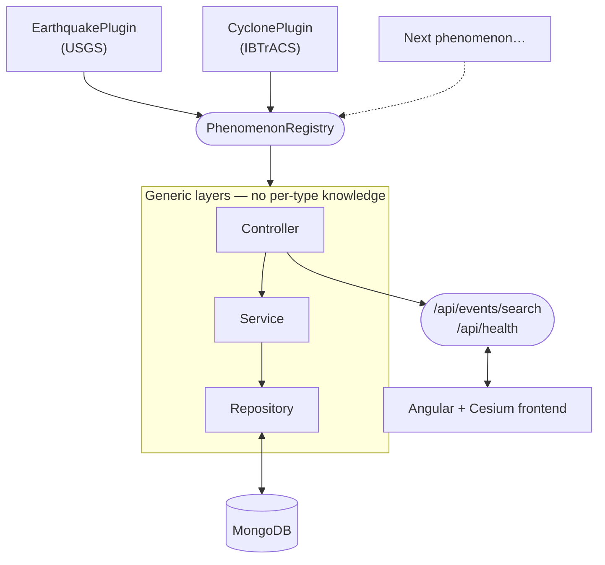

<div align="center">


# AGORA

**A**ll-**H**azard **G**lobal **O**bservation & **R**eporting **A**rchive

_Real-time natural-hazard monitoring on an interactive 3D globe_

[](https://nodejs.org)
[](https://expressjs.com)
[](https://www.mongodb.com)
[](https://angular.dev)
[](https://cesium.com/platform/cesiumjs/)
[](https://www.typescriptlang.org)
[](https://docs.docker.com/compose/)
[](LICENSE)

</div>

---

A full-stack platform that ingests, stores, and visualizes natural-hazard
events — currently earthquakes ([USGS](https://earthquake.usgs.gov)) and
tropical cyclones ([NOAA IBTrACS](https://www.ncei.noaa.gov/products/international-best-track-archive)) —
on an interactive 3D globe, with a single REST API for filtered search
across every registered phenomenon type.

> Born out of an internship with [Sync Lab](https://www.synclab.it) and the
> University of Padova, now continued and maintained independently.

**Highlights**

- A phenomenon/data-source is a self-contained plugin (ingestion,
  search-param parsing, query-building, projection — all in one class),
  not logic scattered across shared layers — see [Architecture](#architecture) below.
- `GET /api/health` reports per-phenomenon ingestion status (loading /
  ready / failed) and live document counts.
- The API stays reachable immediately on startup; search results fill in
  as the initial data load proceeds in the background, instead of the
  server blocking for however long a full historical reconstruction takes.
- Each phenomenon type owns how it's drawn on the map and what detail it
  shows — a frontend `EventTypeStrategy` mirrors the backend's plugin, so
  a new phenomenon brings its own rendering without touching shared
  map/detail code.

## Structure

This is a two-service monorepo:

```
backend/    Node.js + Express + MongoDB REST API. Ingests events from
            external sources via a plugin-based Strategy pattern
            (see backend/src/plugins) and exposes a unified /api/events
            search endpoint across all registered phenomenon types.
frontend/   Angular + Cesium single-page app. Renders events on a 3D
            globe, with filtering, a detail panel, and per-phenomenon
            map rendering (point markers for earthquakes, full tracks
            for cyclones).
```

Each service has its own `package.json`, `Dockerfile`, and CI workflow
(`.github/workflows/backend-ci.yml` / `frontend-ci.yml`, triggered only
by changes under their own folder) — they can be developed and deployed
independently, while sharing one repository and one orchestration layer.

## Architecture

The backend's defining trait: every phenomenon/data-source is one
self-contained plugin, consulted by a registry — the generic
controller/service/repository layers never hardcode a type's name or
fields, so adding a new one touches no shared code.



Adding a new phenomenon/data source means implementing one new
`IPhenomenonPlugin` and registering it — nothing else in the diagram
above changes. See
[`backend/src/plugins/IPhenomenonPlugin.ts`](backend/src/plugins/IPhenomenonPlugin.ts).

The frontend's equivalent — extending `EventTypeStrategy` so a
phenomenon's filter fields and map rendering are both owned by one class
instead of hand-written branches in shared components — is a planned
follow-up, not yet done.

## Running it

**Pre-built images, no build step:**

Every [tagged release](https://github.com/Khaleeja/agora-hazard-observatory/releases)
publishes `ghcr.io/khaleeja/agora-backend` and `ghcr.io/khaleeja/agora-frontend`
(both `:<version>` and `:latest`). Point `docker-compose.yml`'s `backend`/
`frontend` services at `image: ghcr.io/khaleeja/agora-backend:latest` (etc.)
instead of their `build:` keys to use these directly — everything else
(`.env`, `setup-env.js`) stays the same. The published frontend image is
built without a real `ARCGIS_API_KEY` (see [below](#environment-variables)),
so it ships with no embedded key; it works out of the box on the default
OpenStreetMap basemap, and the optional "ArcGIS World Imagery" layer needs
you to build your own image with your own free key instead.

Without a cloned repo at all (just the image, e.g. plain `docker run`),
there's no local `backend/logs` folder for the backend to bind-mount its
logs to — they'd stay locked inside the container, lost on removal. Point
them at a folder of your own instead:

```sh
docker run -d --env-file backend.env -v "C:\wherever\you\want\logs:/app/logs" ghcr.io/khaleeja/agora-backend:latest
```

**Everything, via Docker (building from source):**

```sh
node scripts/setup-env.js  # creates .env + backend/.env with fresh random Mongo credentials
docker compose up --build
```

`setup-env.js` generates its own random MongoDB username/password and writes
the same pair into both files — safer than copying the `.env.example`
templates by hand, which would otherwise leave their literal placeholder
credentials (`some_admin`/`some_password`) in place if you forget to
change them. It never overwrites an existing `.env`, so it's safe to run
again later. You can still `cp .env.example .env` yourself instead if you
specifically need to point at credentials of your own (e.g. an existing
shared MongoDB) — either way, fill in `ARCGIS_API_KEY` by hand afterward.

The frontend is served on `http://localhost:8080`. Note: the frontend
container doesn't need `frontend/src/environments/environment.ts` — the
ArcGIS key reaches it as a Docker build argument instead (see below for
when you _do_ need that file).

**Backend only, for local development:**

```sh
cd backend
cp .env.example .env
npm ci
npm run dev
```

**Frontend only, for local development:**

```sh
cd frontend
cp src/environments/environment.example.ts src/environments/environment.ts  # fill in ARCGIS_API_KEY
npm ci
npm start
```

Angular embeds this file into the JS bundle at _build_ time (not read from
an env var at runtime), which is why it's a separate step from the root
`.env` above — that one only matters for the Docker build path. Requires
the backend reachable at `http://localhost:3000` for `/api/` calls.

See [`backend/README.md`](backend/README.md) and
[`frontend/README.md`](frontend/README.md) for full project-specific
details (testing, linting, production builds, Docker options).

## Environment variables

### Root `.env` (orchestration — read by `docker-compose.yml`)

| Variable                                      | Purpose                                                                                                                                                                    |
| --------------------------------------------- | -------------------------------------------------------------------------------------------------------------------------------------------------------------------------- |
| `ARCGIS_API_KEY`                              | Passed to the frontend build as a Docker build argument (its basemap/imagery provider). Leave empty for local dev — the build falls back to a placeholder.                 |
| `MONGO_ROOT_USERNAME` / `MONGO_ROOT_PASSWORD` | Root credentials for the `mongodb` container. Must match the ones embedded in `backend/.env`'s `MONGO_URI` below — they're two separate files, but one set of credentials. |
| `MONGO_COMPASS_PORT`                          | Set to `27017` to expose MongoDB on `localhost` (e.g. to inspect it with MongoDB Compass). Leave empty to keep it reachable only from other containers.                    |

### `backend/.env` (the API service itself)

| Variable                                                | Purpose                                                                                                                                                        |
| ------------------------------------------------------- | -------------------------------------------------------------------------------------------------------------------------------------------------------------- |
| `MONGO_URI`                                             | Full connection string. Use host `mongodb` when running via the root `docker-compose.yml`, `localhost` when running the backend directly with `npm run dev`.   |
| `PORT`                                                  | Port the Express server listens on (`3000` by default).                                                                                                        |
| `CORS_ORIGIN`                                           | Allowed origin for browser requests — the frontend's own origin in development (`http://localhost:4200`), or wherever it's actually served from in production. |
| `LOG_LEVEL` / `LOG_FILE_PATH`                           | Winston logging verbosity (`error`\|`warn`\|`info`\|`http`\|`verbose`\|`debug`) and where logs are written.                                                    |
| `MAX_EVENTS_LIMIT`                                      | Hard cap on `limit` for `/api/events/search`, regardless of what a caller requests.                                                                            |
| `SCHEDULER_TRIVIA_INTERVAL`, `AI_API_KEY`, `AI_API_URL` | Reserved for phenomena/features that don't have a plugin yet — currently unused by any registered plugin.                                                      |

### Frontend build-time key

Not a `.env` file at all — Angular embeds `frontend/src/environments/environment.ts`
into the JS bundle at _build_ time (see [Running it](#running-it) above).
Required for `npm start`/`ng serve`; for the Docker build, `ARCGIS_API_KEY`
above is used instead.

## Changelog

See [CHANGELOG.md](CHANGELOG.md) — backend and frontend share one version
number for the whole stack.

## License

MIT — see [LICENSE](LICENSE).
